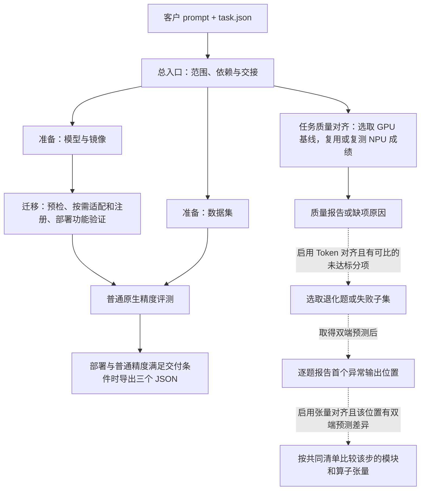

# Model Migration Skills

**面向 vLLM / vLLM-Ascend 的模型资产准备、迁移部署与精度测试 Skills。**

将模型、镜像和数据准备，支持度预检，必要的源码适配与框架注册，部署功能验证和原生精度评测串成可追溯的流程。你可以从客户 `prompt + task.json` 开始，也可以按需使用独立阶段或任务。

[快速开始](#快速开始) · [工作流程](#工作流程) · [交付物](#交付物) · [文档导航](#文档导航) · [参与开发](#参与开发)

> 当前实现已通过本地离线回归，并取得 Qwen3.5-27B 的部署功能及部分精度实机证据；完整客户流程、其他模型/评测 SDK 组合及宿主发现仍需单独验收。版本和证据以[项目当前状态](docs/PROJECT_BRIEF.md#当前状态)及[验证基准](docs/TESTING.md#当前验证基准)为准。

## 为什么使用本项目

- **按任务选择范围**：支持完整部署与精度流程、仅准备、仅部署、已有服务精度测试、独立任务及历史分析。
- **复用已有资产**：核验后复用本地权重、镜像、数据和服务；仓库 ID 与本地模型同时提供时，先核对身份一致再复用，冲突时确认且不覆盖。远程来源依次检查 ModelScope、Hugging Face。
- **保留适配判断**：根据目标版本与模型证据区分支持候选、需要注册、需要适配或阻塞；Agent 完成源码适配和语义复核。
- **使用原生评测**：新测量默认 EvalScope，兼容显式 AISBench；保留原生模板、评分和数据身份，分别判断测量有效性、GPU/NPU 可比性和目标达标情况。
- **共用环境与证据**：客户 EvalScope 每次有效正式准备调用原版安装脚本，续接继承环境并核对实际绑定；性能启动前另行核验 Python、venv、CLI、版本和当前 PATH，实际两端共用须有进程证据。
- **交付可核验配置**：完整 EvalScope 客户流程联合校验、整体发布三个 JSON，保留独立导出回执、文件路径和 SHA256。
- **按输出 Token 回查运行数据**，通过 `verify-agent` 可找到产生该 Token 的实际前向、msProbe 张量及已适配层的缓存原值。同步 Eager 按所选物理卡数处理单机张量并行，双卡已有实机记录，四卡和八卡已做离线验证，单卡文本请求还支持 ACLGraph。MLA 缓存适配范围为单卡同步 Eager。[运行时采集工具](skills/vllm-model-migration/skills/vllm-migration-execute/skills/verify-agent/references/runtime-capture.md)

本仓交付的是包含指令、脚本、契约和模板的 Skills。Agent 负责需求理解、资料核对、源码适配与语义复核；脚本负责确定性执行和证据记录。使用本项目无需启动 MoFix 后端。

## 快速开始

### 1. 准备运行条件

| 场景 | 所需条件 |
| --- | --- |
| 阅读、帮助和客户输入计划 | Python 3.10+，完整总 Skill 目录；无需模型、Docker 或 NPU |
| Agent 协作 | 能读取 `SKILL.md`、契约并执行公开 CLI 的 Agent；具体宿主的发现与调用须单独验证 |
| 实际迁移部署 | 本次获准使用的目标 Linux/昇腾环境、已有驱动/CANN/Docker、明确的模型与镜像和资源约束 |
| 精度测量 | 已核验服务、原生数据集和兼容评测环境；客户模式每次准备调用随包安装脚本，精度与性能交接使用同一 EvalScope 环境 |

系统条件缺失时报告阻塞；必要 SDK 与评测依赖按本次任务在隔离环境准备。完整使用条件见[安全边界](docs/SAFETY_POLICY.md)。

### 2. 让 Agent 读取总入口

从 [vllm-model-migration/SKILL.md](skills/vllm-model-migration/SKILL.md) 开始。搬迁使用时保留整个 `skills/vllm-model-migration/`，包括所有嵌套目录；单独复制某个子 Skill 不构成完整运行资源。

目录齐备不保证 Codex、Claude Code 等宿主会自动递归发现所有 Skill。使用前应明确指向总入口，并按所用宿主核验调用方式。

### 3. 准备 prompt 与 task.json

将示例复制到技能资源目录之外，按实际执行主机填写 `model`、`environment`、`accuracy` 三组信息，另指定证据工作根和 `run-id`。`model.model_name` 同时用于任务记录、展示和 API 服务名。按任务选择[基础模板](skills/vllm-model-migration/assets/template.json)、[含 GPU 基线的任务质量示例](skills/vllm-model-migration/assets/task-quality.example.json)或[任务质量、Token 预测和张量三层对齐示例](skills/vllm-model-migration/assets/three-level-alignment.example.json)。

例如，交给 Agent 的任务描述可以是：

```text
请按 skills/vllm-model-migration/SKILL.md，使用我提供的 task.json，
在本次获准使用的目标环境完成模型部署和精度基线，交付三个 JSON。
证据工作根与 run-id 使用本次明确指定的值。
请先做计划检查，再按契约完成发现、执行与必要续接，报告实际服务状态。
```

填写时注意：

- 支持默认值的字段可以省略、填 `null` 或 JSON 整数 `-1`。显式指定设备、普通评测数据集或子集时，列表须非空。`accuracy.gpu_baselines` 也接受 `[]`，与未提供基线等价。有精度评测意图时，Agent 会按模型查找公开 GPU 基线。[客户字段契约](skills/vllm-model-migration/references/customer-task.md#字段)
- 三个分组允许空对象；显式数据集列表的每项必须提供 name。模型名可按契约自动确定，ceval/gsm8k 的路径可采用默认值，其他数据集须明确路径。模型、设备、样本范围和资源预算以本次任务为准。
- 数据路径不存在时，Agent 查阅官方来源，优先读取有依据的默认本地位置；可用则复用，默认位置缺失或未提供时下载到客户指定路径。已有坏数据保留并报错，用户无需增加字段；详见[数据来源选择](skills/vllm-model-migration/skills/vllm-migration-prepare/skills/vllm-dataset-prepare/references/contract.md#指定路径缺失时的来源选择)。
- `environment` 使用 `image_name`、`container_name`、`available_npu_devices`。设备列表限定允许范围，优先选择满足逐卡预算的全空闲组合；不足时允许共享占用卡，共享组合中每张卡额外预留剩余显存的5%。选卡不要求用满列表，也不代表性能最优 TP，详见[共享部署契约](skills/vllm-model-migration/references/customer-observations.md#空闲优先与共享部署)。EvalScope 默认安装到共享 /data/evalscope-venv，安装选项仅放在可选内部 context，见[共用环境契约](skills/vllm-model-migration/references/evalscope-installation.md)。
- prompt 与 JSON 显式值有冲突时先澄清。客户无需手写内部阶段请求、评测命令或压测负载。
- 模板的 `image_name` 固定了示例镜像。希望自动选版时删除该字段、填 `null` 或整数 `-1`。流程在官方 Quay 的最高基础版本中优先选正式发布（含修订版），仅有 RC 时选编号最大的 RC。A3 等变体需明确填写。[缺省镜像选择](skills/vllm-model-migration/references/customer-task.md#缺省镜像选择)

完整字段和默认行为见[客户输入契约](skills/vllm-model-migration/references/customer-task.md)。

### 4. 先运行无外部效果的计划检查

在仓库根执行帮助命令：

```bash
python3 -B skills/vllm-model-migration/scripts/migrate.py --help
```

填写好 `task.json` 后运行计划。下列路径和运行标识均为占位示例，须换成本次实际值：

```bash
python3 -B skills/vllm-model-migration/scripts/migrate.py \
  --task /ABSOLUTE/PATH/task.json \
  --work-root /ABSOLUTE/PATH/work-root \
  --run-id REPLACE_RUN_ID \
  --plan
```

客户 `--task --plan` 只校验客户输入并报告计划，不安装、不下载、不接触设备，也不创建运行目录。计划通过不代表模型受支持、部署成功或精度有效。

真实执行由 Agent 按[执行与续接契约](skills/vllm-model-migration/references/customer-observations.md)完成环境发现、资料核对和内部 `--context` 准备，再调用同一公开入口；去掉 `--plan` 本身不足以完成整条流程。续接使用原 `task.json`、`run-id` 和上次回执，保留原始输入及历史结果。

## 工作流程

交付采用 **1 个总入口 → 3 个阶段 → 10 个任务，共 14 个 Skill**。下图表示依赖，实际执行范围由本次请求决定。



| 层级 | Skill | 职责 |
| --- | --- | --- |
| 总入口 | `vllm-model-migration` | 选择范围、组织阶段依赖、核验回执与交接 |
| 准备阶段 | `vllm-migration-prepare` | 委托资产准备、核验身份和准备交接 |
| ↳ 准备任务 | `vllm-model-prepare`、`vllm-image-prepare`、`vllm-dataset-prepare` | 分别准备模型、镜像和数据 |
| 迁移阶段 | `vllm-migration-execute` | 按支持路线组织适配、注册和部署验证 |
| ↳ 迁移任务 | `vllm-model-precheck`、`adapt-agent`、`vllm-model-register`、`verify-agent` | 分别负责预检、源码适配、框架注册、部署功能验收；verify-agent 另提供可选运行时采集 |
| 精度阶段 | `vllm-precision-align` | 组织测量或历史分析，汇总比较与目标结论 |
| ↳ 精度任务 | `verify-agent-plus` | 执行原生精度评测、复核已有成绩，按选题清单重跑并关联同一请求的评分和预测 |
| ↳ 精度任务 | `vllm-precision-compare` | 比较总分、分项和逐题评分，定位首个异常 Token，按调用比较 GPU/NPU 张量及适用的 CPU 参考 |
| ↳ 精度任务 | `three-step-demarcation` | 按需对服务链路做三步定界 |

阶段通过公开 CLI 和文件契约调用任务。`verify-agent` 唯一管理模型服务，精度任务只管理自有评测进程，borrowed 服务保持运行。独立步骤失败时保留其他有效成果，仅阻塞其实际消费者。

仅准备、仅部署、已有服务评测等场景，以及旧 `--request` 接口，从[接口索引](docs/INTERFACES.md)选择入口并阅读对应契约。历史 `analyze` 只核验已有产物，不查询 latest、不新增推理或重新评分。

## 交付物

完整客户流程的交付布局：

```text
<work-root>/<run-id>/
├── customer-workflow/          # 冻结请求、尝试台账及独立导出回执
└── deliverables/
    ├── benchmark_plan.json
    ├── accuracy_plan.json
    └── deployment.json
```

| 文件 | 内容与用途 |
| --- | --- |
| `benchmark_plan.json` | 服务与初始负载配置，供下游性能测试使用 |
| `accuracy_plan.json` | 与本次有效基线绑定的评测配置和数据选择 |
| `deployment.json` | 与实际部署证据一致的 vLLM 参数及运行环境 |

完整交付要求部署验证、全部必需精度项有效、三个 JSON 校验通过，并取得独立导出 `status=ready` 回执及三份文件的路径/SHA256。仅部分阶段和历史分析不强制三文件；旧 `--request` 的 `completed` 只表示阶段执行结束，不能替代导出。

测量有效、GPU/NPU 可比和目标达标分别判断。有效精度测量可能未达到目标，交接成功也不表示性能优化完成。详细规则见[三文件交付契约](skills/vllm-model-migration/references/tuning-handoff.md)。

任务质量结果保存在本次运行的 `customer-manifest.json` 中，其路径见入口输出的 `evidence.manifest`。打开 `task_quality[]` 中的报告引用 `report`，可查看成绩、逐题变化或缺项原因。自动搜索未取得完整 GPU 基线时，该项记为 `not_evaluated`（无法判断是否对齐），流程继续检查三份 JSON 的交付条件。[任务质量对齐契约](skills/vllm-model-migration/references/task-quality.md)

需要定位首个异常输出 Token 时，在 `accuracy.token_alignment` 下填写两项绝对容差。按失败分项选题并取得二遍预测包后，查看客户回执中的 `token_alignment[].token_report`。[字段、二遍选择与续接](skills/vllm-model-migration/references/task-quality.md#从未达标分项进入-token-预测对齐)

若 Token 报告已定位同一前文下的预测差异，可用 `accuracy.tensor_alignment` 对比该步的模块和算子。在客户回执的 `tensor_alignment[].tensor_report` 中查看超限调用、元素坐标和缺项。当前覆盖单卡、单请求、同步 Eager 文本贪心生成，离线用例使用合成 GPU/NPU 证据。[采集、客户证据和复算](skills/vllm-model-migration/skills/vllm-precision-align/references/tensor.md)

## 支持范围与当前限制

- 当前面向 vLLM / vLLM-Ascend；SGLang、框架自动选择、重新量化、训练、多机调度及自动算子根因定位不在当前范围内。
- 提供性能测试配置交接，不执行正式压测、性能优化或性能目标验收；不提供自动异常修复循环。
- 显式 AISBench 可执行精度测试，当前不支持三个 JSON 的完整交付；不会自动切换到 EvalScope。
- 不提供 Agent 宿主插件发布、HTTP 服务或后台调度。vLLM 模型注册的 `mode=plugin` 仍是业务能力。
- 离线计划、合成回归和历史实测不能替代当前目标环境验收。剩余验证工作见[路线图](docs/ROADMAP.md)。

## 仓库结构

```text
model_migration/
├── README.md                       # 使用入口与文档导航
├── AGENTS.md                       # 项目开发与授权规则
├── docs/                           # 范围、架构、接口、流程与验证
├── skills/vllm-model-migration/     # 完整业务 Skill 资源
│   ├── SKILL.md
│   ├── scripts/                    # 总入口与共享路径能力
│   ├── references/                 # 契约、Schema 与布局
│   ├── assets/                     # 客户模板和静态示例
│   └── skills/                     # 阶段与任务 Skill
├── tests/vllm-model-migration/      # 离线回归
├── .agents/skills/                 # 随仓库提供的开发工作流技能
└── .codex/                         # 结构质量策略与基线
```

模型、数据、镜像归档、请求和运行证据保存在明确的技能资源外位置。开发工作流技能与业务 Skill 的职责和交付资源分开，详见[架构](docs/ARCHITECTURE.md)。

## 文档导航

| 想了解什么 | 从这里开始 |
| --- | --- |
| 项目定位与现状 | [项目简介](docs/PROJECT_BRIEF.md) |
| 需求与完成标准 | [功能规划汇总](docs/MODEL_MIGRATION_FEATURE_PLAN_SUMMARY.md) |
| 客户输入和执行 | [客户字段](skills/vllm-model-migration/references/customer-task.md) · [Agent 执行与续接](skills/vllm-model-migration/references/customer-observations.md) |
| 三层组织与资源归属 | [架构](docs/ARCHITECTURE.md) |
| 公开 CLI、字段和兼容性 | [接口索引](docs/INTERFACES.md) |
| 检查命令与证据边界 | [验证](docs/TESTING.md) |
| 外部操作与资源所有权 | [安全边界](docs/SAFETY_POLICY.md) |
| 开发与贡献规则 | [工作流程](docs/WORKFLOWS.md) · [代码质量](docs/CODE_QUALITY.md) · [开发技能索引](docs/DEVELOPMENT_SKILLS.md) |
| 后续验收与缺口 | [路线图](docs/ROADMAP.md) |

## 参与开发

开始前阅读 [AGENTS.md](AGENTS.md) 和[工作流程](docs/WORKFLOWS.md)。从当前本地 `dev` 创建 `codex/<任务名>` 分支，完成最小改动、验证和审查；提交与合入 `dev` 分别取得授权，提交信息使用中文。本仓默认不 push、不创建远程 PR，不修改 `main` 引用。

常用离线检查如下，完整命令及适用范围见[验证文档](docs/TESTING.md)：

```bash
git diff --check
python3 -B -m unittest discover -s tests/vllm-model-migration -p 'test_*.py' -v
python3 -B .agents/skills/codebase-organization-guardrails/scripts/source_shape_audit.py \
  --repo-root . --policy .codex/code-structure-policy.toml \
  --baseline .codex/code-structure-baseline.json
```

纯文档改动按范围执行链接、内容、差异和结构检查，无需运行模型、下载资产或安装依赖。

## 许可与致谢

当前仓库未提供根级 `LICENSE`，本文不声明整仓的开源许可。随仓库提供的第三方开发技能保留各自许可和[来源清单](.agents/skill-sources.json)，不能据此推定整个项目的许可。

本 README 的信息组织参考了 [vLLM](https://github.com/vllm-project/vllm/blob/main/README.md)、[Transformers](https://github.com/huggingface/transformers/blob/main/README.md) 和 [uv](https://github.com/astral-sh/uv/blob/main/README.md) 的项目介绍、快速开始、文档导航与贡献章节；具体能力和使用方式以本仓契约为准。
