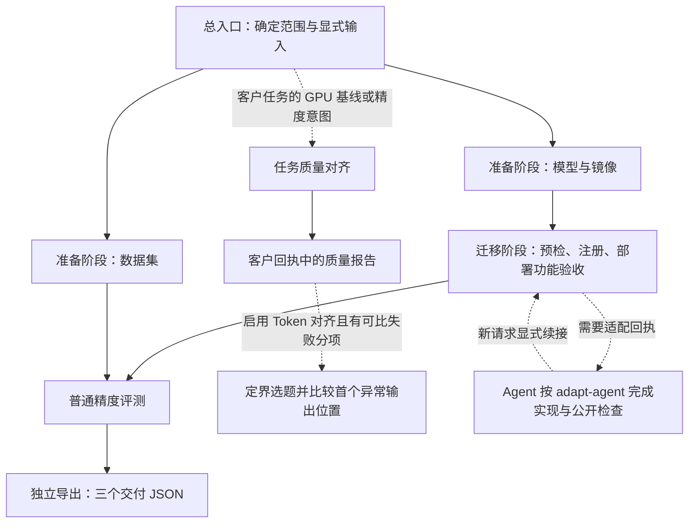

# 模型迁移 Skills 架构

本文面向 `model_migration` 的维护者，说明技能职责、调用关系、资源边界和当前迁入状态。任务质量对齐部分于 2026-11-25 核对。具体输入字段、CLI 参数和任务完成条件以各 Skill 的现行契约及源码为准。

维护规则从 [AGENTS.md](../AGENTS.md) 进入；[项目简介](PROJECT_BRIEF.md)索引文档职责，[代码质量](CODE_QUALITY.md)唯一维护源码组织与增长约束，[接口索引](INTERFACES.md)、[工作流程](WORKFLOWS.md)、[验证](TESTING.md)和[安全边界](SAFETY_POLICY.md)分别维护对应规则。本文继续负责实际架构和资源路径契约，不重复维护 Git 审批与质量阈值。

**当前状态：客户默认值与 prompt 补值、阶段请求/续接、三文件整体发布、EvalScope 共用安装与性能启动前核验、EvalScope 任务质量对齐均已合入本地 dev。路径、布局、导入、输出保护及资源复制保留兼容。客户总入口到三文件交付的实机全流程、其他模型和 SDK 组合、两端环境共用及宿主发现仍待验收。** Git 与验证状态见[项目当前状态](PROJECT_BRIEF.md#当前状态)和[验证基准](TESTING.md#当前验证基准)；目标服务器的验收范围以实测记录为准。

## 1. 项目定位与范围

本仓提供面向 vLLM / vLLM-Ascend 的模型资产准备、支持度预检、模型实现适配、框架注册、部署功能验收、精度评测和三文件交接。使用者是模型迁移、推理部署及基础设施工程师；实际设备、模型、框架版本、资产路径和运行约束由每次请求明确提供。

交付形态为一套嵌套的 Skills。技能包含指令、确定性脚本、参考资料与模板，不提供 HTTP 服务、后台调度服务或数据库，不依赖 MoFix 后端、命令注册、配置或会话系统。Agent 负责理解需求、选择入口、完成模型实现适配和语义复核；脚本负责输入检查、阶段委托、身份核验、进程执行和证据记录。

本仓不包含 Agent 宿主的插件注册、marketplace、安装发布、构建器或发布包校验器。目录嵌套本身不保证任何宿主会自动递归发现全部技能；宿主发现和调用需要单独验证。

当前业务范围不包含：

- SGLang 迁移路线、框架自动选择、MoFix 后端接口接入。
- 性能优化执行、正式压测、容量或性能目标验收、参数搜索。
- 算子、通信、内存等运行异常的自动诊断修复和重试循环。
- 重新量化、训练、多机调度，以及精度评测后的自动诊断和逐层激活值定位。

性能目标可以记录为 `not_evaluated`；模型部署与精度基线完成后可导出三个交付配置。这不等于本仓执行性能优化，也不能由单机实例推导多机支持。

## 2. 当前目录与资源归属

```text
model_migration/
├── docs/
│   └── ARCHITECTURE.md
└── skills/
    └── vllm-model-migration/                    # 总入口
        ├── SKILL.md
        ├── scripts/
        │   ├── migrate.py
        │   ├── export_handoff.py
        │   ├── skill_paths.py                  # 共享路径与资源归属
        │   ├── coordination/                  # 旧内部请求编排
        │   ├── customer_workflow/             # 客户输入、请求生成与续接
        │   └── tuning_handoff/
        ├── references/
        │   ├── contract.md
        │   ├── task-result.schema.json
        │   ├── tuning-handoff.md
        │   └── skill-layout.json               # 相对完整总 Skill 根
        ├── assets/
        └── skills/
            ├── vllm-migration-prepare/
            │   └── skills/
            │       ├── vllm-model-prepare/
            │       ├── vllm-image-prepare/
            │       └── vllm-dataset-prepare/
            ├── vllm-migration-execute/
            │   └── skills/
            │       ├── vllm-model-precheck/
            │       ├── adapt-agent/
            │       ├── vllm-model-register/
            │       └── verify-agent/
            └── vllm-precision-align/
                └── skills/
                    ├── verify-agent-plus/
                    ├── vllm-precision-compare/
                    └── three-step-demarcation/
```

仓库根另有 `.agents/skills/` 保存团队开发工作流技能，`.codex/` 保存质量策略和基线；两者的使用见 [开发技能索引](DEVELOPMENT_SKILLS.md)。它们属于维护资源，不属于上图的 14 个模型迁移业务 Skill，不计入业务运行资源或模型运行载体。

子 Skill 的内部资源在图中省略。每个 Skill 都有自己的 `SKILL.md`；`scripts/` 承担确定性操作，`references/` 保存契约与知识，`assets/` 保存模板和静态示例。`adapt-agent` 沿用单数 `reference/`，资源枚举与维护时需要保留这一实际目录。

截至本次核对，技能树有 **14 个 Skill**，资源数量由当前目录枚举，实测记录见 TESTING.md；文件由布局和静态资源规则从当前目录枚举，不保留构建资源清单。本架构文档与仓库测试位于技能树之外。模型权重、数据集实体、镜像归档、实际请求、日志及运行证据由用户指定位置保存，不纳入技能静态资源。

### 2.1 路径支持与布局

| 文件 | 实际职责 | 当前状态 |
| --- | --- | --- |
| [scripts/skill_paths.py](../skills/vllm-model-migration/scripts/skill_paths.py) | 技能根、直属资源、完整副本及实际字节快照 | 根据自身位置、布局和明确的静态资源规则工作，不依赖 cwd、Git 或构建入口 |
| [references/skill-layout.json](../skills/vllm-model-migration/references/skill-layout.json) | 记录 14 个入口的名称、相对路径、层级和入口资料 | Skill 路径相对总 Skill 根，总入口 path 为 .；入口脚本仍相对各自 Skill |

`owned_files()` 枚举所选 Skill 直接拥有的当前资源，不收入嵌套子 Skill；`bundle_files()` 验证并枚举全部声明 Skill。准备阶段和两条注册复制链路使用同一套纳入规则，实际摘要保留在原有回执中。角色、类型、必需项和拒绝边界以[总入口契约](../skills/vllm-model-migration/references/contract.md#静态资源路径契约)及源码为准。

### 2.2 依赖方向

总入口调用阶段，阶段通过公开 CLI 调用任务；不导入兄弟 Skill 的私有业务实现。共享 Schema 和交接模板唯一归属总入口。任务读取这些静态契约不等于反向调用总入口。

跨层可复用的路径与资源归属能力集中在 `skill_paths.py`。该文件中的 `plugin_root`、调用方的 `release_root` 等名称仍是原分发实现遗留，不能据名称推断本仓提供宿主插件。

`vllm-model-register` 中的模型 `mode=plugin`、`registration/plugin.py` 和 `vllm.general_plugins` 属于 **vLLM 模型注册机制**，仍是技能业务的一部分。它们与已排除的 Agent 宿主 `.claude-plugin` 注册不同，不能按文件名包含 `plugin` 就删除。

## 3. 三层职责与公开入口

以下主入口及支持 plan 的辅助入口已通过离线帮助/计划检查；模型 resolve.py 提供只读发现而不提供 plan。完整辅助入口见[接口索引](INTERFACES.md#公开入口)，计划不证明真实资产、部署或评测已通过。

| 层级 | Skill | 职责及输出 | 该 Skill 内的公开脚本 |
| --- | --- | --- | --- |
| 总入口 | [vllm-model-migration](../skills/vllm-model-migration/SKILL.md) | 选择 scope、安排阶段依赖、核对交接、记录台账和最终服务策略；完整流程另行导出三个 JSON | `scripts/migrate.py`；辅助导出 `scripts/export_handoff.py` |
| 准备阶段 | [vllm-migration-prepare](../skills/vllm-model-migration/skills/vllm-migration-prepare/SKILL.md) | 选择必需资产、委托任务、核验回执与版本资料，输出准备交接 | `scripts/prepare.py` |
| 迁移阶段 | [vllm-migration-execute](../skills/vllm-model-migration/skills/vllm-migration-execute/SKILL.md) | 支持度分流、消费适配回执、委托注册与部署功能验证，输出迁移交接 | `scripts/execute.py` |
| 精度阶段 | [vllm-precision-align](../skills/vllm-model-migration/skills/vllm-precision-align/SKILL.md) | 核验服务和数据、委托精度测量或历史分析、汇总比较和目标结论 | `scripts/precision.py` |
| 准备任务 | [vllm-model-prepare](../skills/vllm-model-migration/skills/vllm-migration-prepare/skills/vllm-model-prepare/SKILL.md) | 获取或复用模型元数据、tokenizer/processor、权重及索引；记录固定身份 | `scripts/prepare.py` |
| 准备任务 | [vllm-image-prepare](../skills/vllm-model-migration/skills/vllm-migration-prepare/skills/vllm-image-prepare/SKILL.md) | 拉取、加载或复用镜像，核对 ID/digest、平台和来源资料；不启动模型服务 | `scripts/prepare.py` |
| 准备任务 | [vllm-dataset-prepare](../skills/vllm-model-migration/skills/vllm-migration-prepare/skills/vllm-dataset-prepare/SKILL.md) | 准备数据文件、split/subset 和样本选择，记录数据身份；不负责评分 | `scripts/prepare.py` |
| 迁移任务 | [vllm-model-precheck](../skills/vllm-model-migration/skills/vllm-migration-execute/skills/vllm-model-precheck/SKILL.md) | 按模型配置及目标版本证据判断支持候选、注册需求、适配需求或阻塞 | `scripts/precheck.py` |
| 迁移任务 | [adapt-agent](../skills/vllm-model-migration/skills/vllm-migration-execute/skills/adapt-agent/SKILL.md) | 指导 Agent 实现模型、权重映射与必要 processor；脚本固定上下文及校验适配证据 | `scripts/adapt.py` |
| 迁移任务 | [vllm-model-register](../skills/vllm-model-migration/skills/vllm-migration-execute/skills/vllm-model-register/SKILL.md) | 建立或核验 architecture 到实现的映射，提供开发初检及载体内复验入口 | `scripts/register.py`、`scripts/check.py` |
| 迁移任务 | [verify-agent](../skills/vllm-model-migration/skills/vllm-migration-execute/skills/verify-agent/SKILL.md) | 部署或核验已有服务、最终载体注册复验、真实权重功能验证及服务生命周期 | `scripts/verify.py` |
| 精度任务 | [verify-agent-plus](../skills/vllm-model-migration/skills/vllm-precision-align/skills/verify-agent-plus/SKILL.md) | 使用原生评测工具测量或分析已有结果，记录有效性、可比性和目标结论 | `scripts/validator.py` |
| 精度任务 | [vllm-precision-compare](../skills/vllm-model-migration/skills/vllm-precision-align/skills/vllm-precision-compare/SKILL.md) | 核对 GPU 与 NPU 评分证据，判定总分、分项和可选逐题变化 | `scripts/compare.py` |
| 精度任务 | [three-step-demarcation](../skills/vllm-model-migration/skills/vllm-precision-align/skills/three-step-demarcation/SKILL.md) | 针对可复现的异常 Chat 请求独立执行服务链路三步定界 | `scripts/demarcation.py` |

独立任务可以直接调用；这不表示把单个子目录复制出去就足够，跨技能定位、公共 Schema 和注册复验等依赖仍须一并满足。

`verify-agent` 另提供可选 msProbe 运行时采集：准备配置及部署摘要 → 实际前端/引擎/worker 挂点 → 会话逐请求授权与封存 → 按输出 Token 反查前向及模块/API 文件。指定一次 decode 或冷前缀完整请求时，调度器逐次记录分配，目标层算子实参和 mindie-debugger 数值快照沿同一 forward_id 封存。完整请求的时间线还索引没有接受输出的 prompt 块，并记录每次前向实际消费的 Token。全部实现归 `verification/runtime/capture/`，直接消费部署报告，不依赖 GPU 基线解析或评测 SDK。输入输出及实际覆盖边界见[运行时采集工具](../skills/vllm-model-migration/skills/vllm-migration-execute/skills/verify-agent/references/runtime-capture.md)；独立离线验证及固定环境的真实 NPU 验收见[交付记录](MSPROBE_RUNTIME_CAPTURE.md)。

模型预检读取配置声明的层数和类型。加载模型后，worker 用实际文本层实例生成结构清单，并据此核对 msProbe 调用。缓存采集按实际后端类匹配观察点，核验实现源码、挂点和执行模式。普通注意力观察 K/V，GDN 观察卷积与递归状态，单卡同步 Eager 的 MLA 观察融合输入及写入物理槽的压缩 KV 和 RoPE。两种工具通过同一 `forward_id`、层和调用序号关联。遇到未知实现时，回执逐层标出缺失的内部状态并保留已取得的层边界。[后端适配与查询字段](../skills/vllm-model-migration/skills/vllm-migration-execute/skills/verify-agent/references/runtime-capture.md#单卡同步-eager-的-mla-缓存)

## 4. 实际调用机制与流程

### 4.1 指令与脚本分工

Agent 阅读总入口或用户指定任务的 `SKILL.md`，结合现行契约准备包外请求。确定性脚本按固定公开 CLI 委托，核对原始回执与内容摘要，再形成自己的结果；不同层级不复制下载、部署或评分实现。调用不依赖宿主提供 subagent。

总入口通过 Python 子进程调用阶段 CLI，先计划再执行。旧 `--request` 流程的三个阶段对应四个依赖节点：`preparation`、`dataset_preparation`、`migration`、`precision`；前两个复用同一个准备阶段 Skill，但分别承担模型/镜像与数据准备。

当前脚本按顺序执行就绪步骤，独立项采用失败隔离。**依赖独立不等于并发执行承诺**，本仓没有新增并发 DAG 调度服务。



客户 `--task` 流程在普通精度步骤后、三文件交付前调度任务质量对齐。质量回执写入 `customer-manifest.json` 的 `task_quality[]`。若配置 `accuracy.token_alignment`，精度阶段根据该报告定界，委托原生评测定向采集，再调用比较器并将报告写入 `token_alignment[]`。[比较契约](../skills/vllm-model-migration/skills/vllm-precision-align/skills/vllm-precision-compare/references/token.md)三文件交付按普通精度、部署和导出回执独立判定。

### 4.2 支持度分流与明确续接

- `supported_candidate`：静态证据允许继续部署验证，不是模型已经运行通过。
- `registration_required`：先完成实现映射注册，再进入最终载体复验和功能验证。
- `adaptation_required`：Agent 按 `adapt-agent` 分析并实现适配，完成公开检查后提交固定回执；迁移 CLI 不自动生成模型代码。缺回执时保留缺口，使用新请求续接。
- `blocked`：保留原因，只阻塞真实依赖；不自动换模型、改架构名称、升级环境或进入修复循环。

功能响应需要语义复核时，保留完整原始输出和 `review_required`。完成 `verify review` 后由迁移阶段 `finalize` 生成新的结果；这条路线不重新部署，也不覆盖原失败或待复核记录。总入口通过显式结果引用继续，不承诺自动断点恢复或 exactly-once。

### 4.3 典型范围

| 用户需求 | 入口及依赖 | 完成边界 |
| --- | --- | --- |
| 只准备资源 | 总入口 prepare 或独立准备阶段/任务 | 交付请求范围内的资产与身份；不启动服务 |
| 只部署模型 | 模型/镜像准备或有效交接 → 迁移阶段 | 完成请求的真实功能验收；不强制数据集精度测试 |
| 客户部署意图涉及精度或性能 | prompt + task.json → Agent 观察及阶段请求 → 准备/迁移/精度 → 自动生成并发布 | EvalScope 的客户 completed 包含有效部署、全部必需精度项和独立三文件 ready；不执行性能优化 |
| 部署并做精度基线 | 模型/镜像准备 → 迁移；独立数据准备 → 精度；最终导出 | 有效部署与基线证据及三个交付 JSON |
| 已有服务精度测试 | 精度阶段复用服务和数据；按显式输入补齐依赖 | 不重复部署已核验服务；借用服务保持运行 |
| 只有已有评测产物 | 精度阶段 analyze → 精度任务分析 | 按历史来源核验，不新增准备、部署、推理或评分 |
| 只做支持度分析或适配/注册 | 对应独立任务 | 交付本任务证据，不扩大为整链路验收 |

完整流程中数据失败不阻止独立部署，部署失败不阻止独立数据准备；只有依赖缺失的精度消费者被阻塞。某个独立评测失败不自动取消其他就绪项。取消或共享证据不可写时，停止后续外部效果并保留部分成果。

## 5. 输入、静态契约与运行证据

客户 JSON 由 `model`、`environment`、`accuracy` 三组组成，任务质量对齐使用可选的 `accuracy.gpu_baselines`。环境字段为 image_name/container_name/available_npu_devices，设备池只允许在指定范围内分配。服务地址和空闲端口由内部策略生成。

客户模式从 prompt + [task.json](../skills/vllm-model-migration/assets/template.json) 开始。总入口 customer_workflow 负责按字段的缺失/null/整数 -1 语义、Agent 观察绑定、逐阶段请求生成及续接：contract 先校验显式值，context 合成一次 prompt 后应用静态默认，前置检查和 runner 共享结果；原 inputs 快照只用于追溯。自然语言、官方资料、源码适配和语义判断仍归 Agent。准备阶段拥有模型/镜像/数据准备，客户 EvalScope 每次调用共用安装脚本，AISBench/资产 SDK 保留既有流程；verify-agent 唯一操作服务，精度任务只操作自有评测进程，tuning_handoff 从有效证据生成并联合校验三文件。全流程和独立任务共用原公开 CLI，不导入兄弟私有模块。详细流程见[客户契约](../skills/vllm-model-migration/references/customer-task.md)。

数据集 prompt 保留列表接口，由 intent.compose 一次返回合成声明与冲突；名称序列一致时逐字段补齐 path/subset_list/limit。contract 共用明确字段规则，并分别校验客户完整条目和 prompt 部分条目。未改变原生 catalog、准备、精度和交付所有权；它们消费同一合成选择并继续核对实际证据。

镜像观察的来源转换归 `customer_workflow/compile/deployment.py`：保留原观察，将安装包的 `runtime_path` 分离为容器路径映射，预检仅消费契约允许的来源字段。新部署或未完成部署的续接在模型/镜像准备完成后，由 effects 调用公开 `precheck.py --plan`，通过后才进入功能输入观察、容量分配和容器处理。`precheck_plan=not_run` 只证明请求形状有效，正式支持度仍由迁移预检判断；路径映射作为证据保存，不替代 `runtime.files`。字段与失败证据见[镜像来源转换与提前校验](../skills/vllm-model-migration/references/customer-observations.md#镜像来源转换与提前校验)。

新部署在设备分配和容器替换前，由 effects 委托 verify-agent 的公开 functional_inputs 操作；原生 tokenizer 效果归 verify，观察绑定、生成预算与请求编译归 customer_workflow/compile/generation.py。功能与精度最大输入长度共同参与容量规划，真实服务 usage 须与功能观察一致，详见[功能输入与生成预算](../skills/vllm-model-migration/references/customer-observations.md#功能输入与生成预算)。

功能输入观察之后，客户新部署通过公开 `observe(capacity=true)` 采集当前设备容量与占用，再将本次回执及允许池内的设备交给 `allocate(policy=idle_first_shared)`，优先空闲卡，逐卡预算允许时共享占用卡。主机身份、采集时间及原始证据绑定由 verify-agent 校验，允许池和静态配方继续冻结，动态设备状态不冻结。失败后的新部署尝试重新观察，已完成部署或待语义复核的服务保持原续接路径；创建和启动前分别复核固定预算，运行后只复核服务归属与证据。容量不足进入用户更换卡决策，独立准备继续。该流程不提供设备预约；字段、5%预留、时效及失败边界统一见[共享部署契约](../skills/vllm-model-migration/references/customer-observations.md#空闲优先与共享部署)。

### 5.1 输入所有权

| 输入 | 主要消费者与处理方式 |
| --- | --- |
| 模型来源、revision、本地权重和配置 | model-prepare 固定资产身份；客户入口核对 Agent 对仓库与本地模型的身份复核证据，一致后复用；precheck、adapt、register、verify 消费实际产物 |
| 客户 model.model_name | 同一名称用于任务记录、展示、vLLM 服务名及功能/精度 API model；客户输入不兼容旧 served_model_name；原生 vLLM 字段由新名称生成 |
| 镜像、目标版本与运行载体 | 客户缺省镜像由准备阶段的 `operation=image` 选版。客户入口核对配方并将选中的身份写入准备请求，image-prepare 核验本地镜像或按平台 digest 拉取，迁移任务核对代码和运行环境。见[缺省镜像契约](../skills/vllm-model-migration/references/customer-task.md#缺省镜像选择) |
| 目标主机、设备、端口、TP、启动参数 | verify-agent 按本次明确请求执行；示例数字和历史服务器配方不是通用默认值 |
| 数据来源、split/subset、样本范围 | dataset-prepare 固定数据身份；精度任务使用一致的选择与评分配置 |
| 评测解释器、backend、版本及配置 | 客户 EvalScope 继承安装选择、固定首次成功版本，本次开关不继承；已有绑定先只读核验，每次有效正式准备仍调用原版脚本；精度核验原生配置与结果，AISBench/资产 SDK 保持原流程 |
| GPU 基线、精度目标和指标单位 | 精度任务分别判断测量、可比性和目标；缺项不伪造对齐或达标结果 |
| 性能负载及部署交接参数 | 客户模式按实际服务和版本化配方生成候选，旧接口接受显式候选；独立导出器联合核验并发布，不执行性能测试 |

请求、引用文件和执行路径属于实际运行主机；不能把开发机路径直接当成容器或服务器路径。示例中的路径、全零 SHA256 和负载数值须按本次任务替换。源请求和已完成回执保持不变，新的绑定或续接产生独立尝试。

### 5.2 权威契约与产物

输入字段不在本文另造一套 Schema。总入口读取[总入口契约](../skills/vllm-model-migration/references/contract.md)，阶段和任务分别读取各自 `references/contract.md`，适配任务使用 `reference/contract.md`。

[共同任务结果 Schema](../skills/vllm-model-migration/references/task-result.schema.json)要求 `schema_version`、`run_id`、`task_id`、`inputs`、`status`、`conclusions`、`evidence`、`uncovered`。具体阶段 manifest、部署交接及评测报告另由各自契约约束，不把共同 Schema 当作全部结果文件的替代定义。

准备阶段交付 `prepare-manifest.json`、`task-ledger.json`、`prepare-handoff.json` 和子任务回执；迁移、精度与总入口各自维护结果、台账、交接和引用。运行证据保存在用户指定工作根下的独立尝试目录，与技能静态资源分离。

原插件构建的 `resource-manifest.json` 已移除，运行不再读取或重建它。`prepare-manifest.json` 等继续作为实际运行产物，保留资源身份和业务证据。摘要只能证明观察到的文件字节，不能代替可信来源、服务存活、真实推理或评测有效性。

### 5.3 状态与结论

- 执行状态：`not_run / running / completed / failed / blocked / skipped`。
- 分项结论：`pass / fail / not_evaluated / review_required`。
- `completed` 表示操作按契约完成，不等于目标达标。有效评测可以是 `completed` 且精度目标 `fail`，相关 CLI 也可能返回非零退出码。
- 缺前置条件写明 `blocked`，不以 `skipped` 隐藏必需任务失败。排除范围中的诊断技能不是待补依赖。
- 资产完整、框架可注册、服务可达、真实功能通过、精度有效及目标达标分别记录；HTTP 200、非空文本、进程退出码 0 均不能单独替代后续结论。

## 6. 精度与末端交接

### 6.1 精度工具边界

新评测默认 EvalScope；显式 AISBench 与旧 Python 配置按原契约处理。客户 EvalScope 每次有效正式准备调用随包原版 install_evalscope.py，首次默认共享 /data/evalscope-venv。可选 context.evalscope_install 传递原脚本六个参数；续接省略环境字段继承原选择，成功后固定实际版本，操作开关仅本次有效。customer_workflow/evaluation 分别拥有选择证据恢复、参数合成、30 秒只读前检及绑定生命周期；context 与执行消费同一安装计划。安装选项写在 Agent context 中。安装回执保留日志、实际 Python/版本/CLI 与性能环境交接；help/dry_run 独立记录并停止业务，正式环境失败不阻止独立资产步骤。显式换配置在安装前拒绝且不修改原绑定；确认实际变化则永久失效。旧原版安装回执仅凭一致请求/结果/绑定恢复，证据不足或更早 selection 须新任务。资产 SDK 单独准备，本地模型不以评测环境为前提。旧 --request 的 latest 规则不变；完整依赖与行为见[安装契约](../skills/vllm-model-migration/references/evalscope-installation.md)。

精度任务使用已有独立评测环境和原生配置、模板及评分。当前契约描述的服务测量范围是 EvalScope Native/openai_api 与 AISBench、同执行主机 HTTP（含运行时核验的本机其他 IP）、非流式和单次生成；不扩写成任意认证方式、多模态或远程评测协议已经验证。详细边界见[精度任务契约](../skills/vllm-model-migration/skills/vllm-precision-align/skills/verify-agent-plus/references/contract.md)。

数据来源选择归 dataset-prepare：catalog 只返回缺路径指引，Agent 核对官方来源及默认本地位置，准备任务通过 default_local 先读取，明确缺失或未提供默认位置时才下载到客户指定路径；已有坏数据保留失败。C-Eval/GSM8K 的 layout=evalscope 在包外生成独立数据目录和原生元数据，原文件不改。正式 catalog、预算和评测配置绑定准备回执 asset.path；preflight 检查原生加载与样本身份，正式运行再次核验摘要。准备、原生预检和实际评分分别报告，详细字段与来源身份边界见[数据准备契约](../skills/vllm-model-migration/skills/vllm-migration-prepare/skills/vllm-dataset-prepare/references/contract.md)。

普通精度测试中，EvalScope 的 `limit` 为正整数时表示每个所选 subset 的题数上限；未填或为 `null` 时表示所选范围全量。数据选择、实际 sample_ids、评测配置和交接保持一致，不能用示例的小样本数量替代用户输入。输出达到配置上限时保留原生分数并记录截断，不能擅自增加“零截断才算完成”的门槛。 任务质量重跑按 GPU 基线选择的数据范围和原生配置单独预检提示长度与生成预算。

任务质量对齐只使用 EvalScope 的评分证据。报告按原生名称、聚合方式、单位与方向匹配指标。未设置目标时可报告分差。客户提供基线时，精度阶段按评测条件核验已有 NPU 成绩，或委托原生重跑；每次按当前 GPU 分数和目标重新比较。有精度意图且缺少客户基线时，先检索同模型的公开 GPU 基线，查无可核验资料即记录 `not_evaluated` 并继续后续任务。质量评测只留评分及复核所需的证据。对未达标样本，Token 定向复测通过单卡同步 Eager 服务，在同一次贪心生成中关联原生评分和逐步预测。跨端比较使用相同样本和前文，报告首个异常位置。诊断重跑中的逐层张量与算子比较仍待接入。[客户质量与 Token 复测契约](../skills/vllm-model-migration/references/task-quality.md#从未达标分项进入-token-预测对齐)

历史 `analyze` 按原报告或 native 来源身份处理，不查询当前最新版本、不导入评测 SDK、不产生新推理或重新评分；缺失的历史来源不能用新默认值补齐。

性能启动前，Agent 通过独立 check_evalscope_handoff.py 核验客户环境回执和当前 Python/venv/CLI/版本，再使用返回环境调用性能入口。实现归属 customer_workflow/evaluation，保留原始回执并输出独立证据；不自动执行性能任务或修改性能插件。契约见[只读核验](../skills/vllm-model-migration/references/evalscope-installation.md#性能启动前只读核验)。

### 6.2 三个交付 JSON

完整 `deployment_precision/run` 流程在部署功能验证与有效精度基线之后，还须调用独立 `export_handoff.py`。总入口原阶段 `completed` 不代替导出；只有导出回执 `status=ready` 才表示三文件已发布。部分阶段、独立任务和历史分析不强制导出。

客户模式或显式 --layout flat 的最终路径：

```text
work-root/run-id/deliverables/benchmark_plan.json
work-root/run-id/deliverables/accuracy_plan.json
work-root/run-id/deliverables/deployment.json
```

旧导出器默认 legacy，保留原相对布局字面值作为兼容接口。新客户流程只定义输入与三个文件契约；AISBench 保留精度执行，本轮不支持三文件。

导出器核验冻结候选文件、部署与基线身份、原始配置和可表达性，再整体发布；不启动服务、不评分、不执行下游调优。数据集全量使用 `limit: null`。缺参数只阻塞交接，不抹掉已完成的部署与基线，不重复运行前序任务。完整字段、CANN 来源、同配置服务重建关联及当前 EvalScope 导出限制统一见[三文件交付契约](../skills/vllm-model-migration/references/tuning-handoff.md)。

## 7. 服务生命周期与执行边界

`verify-agent` 是模型服务生命周期的唯一所有者；精度任务只拥有本次评测进程，准备任务不启动模型服务，总入口和阶段通过公开入口委托生命周期操作。

| 对象或场景 | 处理规则 |
| --- | --- |
| 本次新建的 owned 服务 | 记录精确进程/容器与设备身份；按实际请求及依赖完成情况管理 |
| borrowed 服务 | 核验后复用，保持运行，不因评测结束而停止 |
| 新部署遇到 task 指定同名且已退出的容器 | 自动委托公开 replace_container；删除前复核完整 CID/image/StartedAt、名称及退出状态，非强制删除后续接重建；其他状态保留精确身份授权 |
| 精度消费者尚未完成 | 服务先保持 keep，内层提前 stop 请求不能抢先关闭服务 |
| 顶层显式 `service_retention=stop` | 消费者结束后委托停止本次新迁移拥有的服务；从已有 migration.result 复用的服务仍保留 |
| 停止失败或身份无法核验 | 如实记录失败或 unknown，不宣称资源已经释放，不按名称或端口全局清理 |

适配或注册在开发目录成功，不表示改动已进入目标运行载体。部署前应把实现纳入实际镜像或明确的开发运行环境，再在最终载体通过 register 的公开检查入口复验，随后做真实权重功能验证。基础资产镜像、开发 import、最终载体检查和模型验收分别记录。

设备编号由 verify/devices 在最终载体创建后、注册检查和模型启动前查询，分别记录宿主物理卡、载体逻辑卡及进程可见索引，再生成并复验有效环境。实际用卡还须通过宿主全设备进程归属检查，不能仅凭可见数量通过。精度阶段经公开 `inspect-devices` 在评测前后复核；导出器通过共享静态证据合同消费有效环境，保留原始请求及 handoff.runtime。两份设备证据绑定宿主、载体、库及启动身份，载体重建后须重新探测；支持范围与失败规则以[设备验证契约](../skills/vllm-model-migration/skills/vllm-migration-execute/skills/verify-agent/references/contract.md#设备编号与有效运行环境)为准。

外部效果包括下载、Docker 操作、代码注册、服务启停和评测子进程。执行依据当前任务输入与授权，保留原始错误及部分结果，不自动回滚、重试或占用未授权设备。执行远程操作前核对目标服务器和本次授权范围。

## 8. 执行环境与部署位置

Python 控制入口要求 Python 3.10+；总入口与阶段本身按契约使用标准库。任务按需使用已有的模型来源 SDK、Docker、目标 vLLM/vLLM-Ascend、Ascend 驱动/CANN、EvalScope 或 AISBench 环境。不同任务可以使用明确指定的解释器；不为读取源码或文档安装这些依赖。

技能目录保存静态资源，用户工作根保存请求和证据，模型/数据/镜像保持各自明确的资产位置。运行时无条件保护完整总 Skill 根，具体路径和复制契约见第 9 节。`docs/` 是仓库维护资料，不作为技能执行资源或容器注册资源一起复制。

远程使用时，由使用者或 Agent 在当次授权范围内把完整技能资源放到目标环境，并在该环境执行公开 CLI；技能本身不新增 SSH 调度系统。本机和远程可以有不同的绝对路径，证据必须明确其所在主机或容器。

旧文档中的 Qwen3.5-27B、设备编号、TP、镜像、驱动和容器状态属于历史开发样例，本文不把它们设为新请求默认值。连接后须重新观察实际硬件、软件版本、镜像、设备占用、模型路径、端口和运行资源归属。

## 9. 路径与资源契约

资源根固定为完整 `vllm-model-migration/` 目录，不能扩大到维护仓库根。`plugin_root()` 和调用方 `release_root` 沿用兼容名称，不表示宿主插件能力。调用模块通过其固定嵌套层级定位总 Skill 的 `scripts/skill_paths.py`，不查找旧 `runtime/`，不依赖 PYTHONPATH。

- 布局 JSON 保存在 `references/skill-layout.json`。`root` 保留 Skill 名称，总入口 `path` 为 `.`；其他 Skill 路径及运行资源证据键相对总 Skill 根，入口 `script`/`plan` 仍相对所属 Skill。
- 仅根 Skill 定位允许 `.`；普通相对路径继续拒绝绝对路径、`..`、非规范分隔与符号链接重定向。根资源枚举使用空前缀，父级不重复收集子 Skill。
- 准备阶段从总入口定位共享 Schema，资源证据统一相对总 Skill 根。旧回执保留原始键和摘要，不改写历史证据。
- 总入口、阶段与任务均保护完整总 Skill 根，不以插件标记选择范围。请求、资产和证据放在根外。
- 注册接收完整总 Skill 根或其直属 `skills/` 目录，也兼容既有平铺注册资源。新嵌套资源从所给副本的索引定位入口；注册与载体复验按统一规则枚举当前静态资源，记录实际集合和摘要，复制前后核对源、目标身份。平铺资源兼容普通文件并排除缓存、日志和维护项；两类布局均拒绝链接和特殊文件。

新增和修改合法静态资源自动反映；删除非必需资源不留下旧名单，缺必需资源明确阻塞对应消费者。布局未登记的嵌套 Skill、未知静态文件类型和越界资源均拒绝。新增类型或 Skill 时维护规则/布局，普通内容更新无需刷新 JSON；运行不会回写静态资源，旧回执不重写。复制检查不是文件系统锁，不能以资源摘要宣称部署或精度通过。

## 10. 验证与当前证据

项目版本见[当前状态](PROJECT_BRIEF.md#当前状态)，各次实机和离线检查的时间、范围与结果见[验证基准](TESTING.md#当前验证基准)。

| 验证层 | 当前证据与边界 |
| --- | --- |
| 客户输入与三文件生成 | 按字段支持缺失/null/整数 -1，prompt 一次合成、来源优先级/冻结、容量与请求、子集和数据摘要、恢复及整体发布有离线回归；外部 SDK/Docker 边界使用模拟，完整实机流程待验收 |
| 路径与离线调用 | 公开入口 help 及主入口 plan、不同 cwd、中文/空格路径搬迁、索引/资源枚举和输出隔离；具体版本与结果见 TESTING |
| 本地准备与失败隔离 | 合成 metadata 与 JSONL 数据准备通过；模型项阻塞时独立数据仍完成，最终状态保留 blocked |
| 注册资源复制 | 本地资源快照复制与模拟 Docker 调用捕获验证通过；只交付业务资源，旧平铺入口定位仍兼容；未调用真实 Docker |
| 容器注册续接与导出 | 合成回执经过实际传输模块、迁移结果复用校验及导出 CLI 发布三 JSON；请求、来源映射或公开计划不一致时拒绝；仅模拟 Docker，不代表真实注册或精度验收 |
| 结构与文档 | 语法、文档链接、结构策略和基线检查；软提示与未覆盖项见验证文档 |
| 实际目标资产、模型/NPU 与精度 | 镜像、catalog、长度/预算和退出容器替换已有原服务器证据；Qwen3.5-27B 复用及新建服务功能通过，一项 C-Eval 子集有效。后续服务被停止，完整精度及三文件未完成；具体范围见 TESTING，不推导当前服务存活 |
| 任务质量对齐 | Qwen3.5-27B 的 GSM8K 单题原生重跑和同题只读复用已在 NPU 验收。GPU 合成分数用于核验比较逻辑，真实双端精度结论仍待可比 GPU 实测证据。[单题验收](TESTING.md#2026-11-25-任务质量对齐单题验收) |
| 宿主发现、取消与超时专项 | 本次未验证；不从目录嵌套或路径回归推断 |

### 原生目录输入长度核验

2026-11-01 首轮服务器验证发现：EvalScope 1.14.1 与 Transformers 5.22.1 的 `apply_chat_template()` 默认返回 `BatchEncoding`，旧代码直接 `len()` 将两个字段误计为 token 数。当前实现的 [catalog.tokens](../skills/vllm-model-migration/skills/vllm-precision-align/skills/verify-agent-plus/scripts/precision/runtime/evalscope/catalog.py) 已显式请求单样本 token ID 列表、禁用填充/截断/张量返回，并校验非空整数列表；异常形态阻塞，不按版本推断或回退猜测。

同一服务器环境重跑公开 catalog 后，45 条样本逐一通过显式字典输出 `input_ids` 与列表输出的内容及长度对照，客户编译器接收新的观察引用并计算真实输入最大值加 8192 的预算；容量不足一 token 的编译前置检查正确阻塞。具体数值与验证范围见[验证记录](TESTING.md#2026-11-01-tokenizer-长度与预算修复)。旧错误 catalog 保留为历史证据，不得继续作为预算输入；提交及合入状态以 Git 为准，完整服务与精度验收仍见[路线图](ROADMAP.md)。

## 11. 设计背景与采用边界

本方案最初形成于 2026-10-13 的模型迁移 Skills 总体规划。原始需求、当前范围及其取舍已整理在本仓的[功能规划汇总](MODEL_MIGRATION_FEATURE_PLAN_SUMMARY.md)中；本文结合当前 Skill、契约、Schema 与脚本说明实际组织和实现边界。历史设计仅用于解释背景，现行规则与使用依据均由本仓文档和资源提供。

| 设计背景 | 本仓采用方式 |
| --- | --- |
| 三层职责、整套资源交付、配方与流程分离、分层验收 | 保留设计原则，结合现行源码说明公开 CLI 和任务归属 |
| 原物理同级目录及计划新增文件 | 改为本仓已存在的嵌套目录；路径契约和离线证据分别见第 9、10 节 |
| 输入产物、执行状态、资源生命周期、典型场景 | 按现有契约和实际实现核对后保留，纠正并发和自动适配等过度推断 |
| 旧 27 项资产盘点、历史静态缺陷及实施顺序 | 不作为本仓现状或新授权待办；当前资源与已知缺口分别以第 2、9 节为准 |
| Agent 宿主插件注册、命名空间、安装发布和发布包校验 | 不纳入本仓架构与使用入口 |
| GitHub 调研、固定源码快照、旧硬件/模型验收 | 仅作为历史设计背景，不作为本仓当前支持或验收依据；本次验证范围见第 10 节 |
